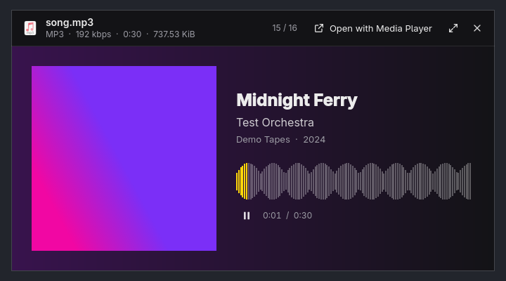
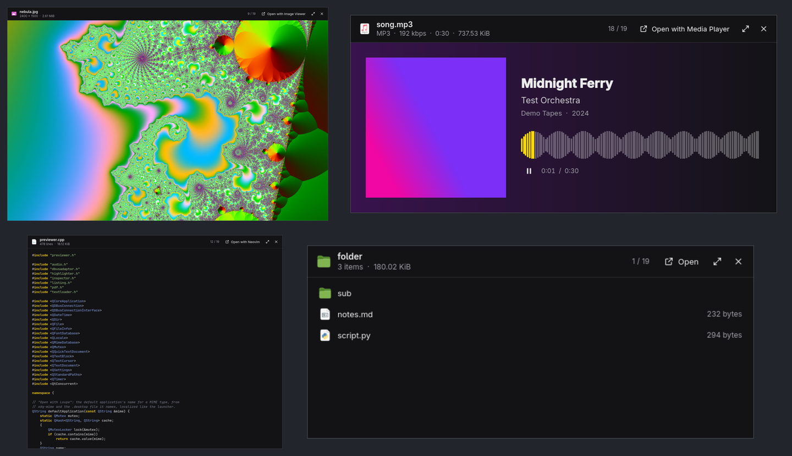

<div align="center">


# Gander

**Quick Look for Linux.** Select a file, press <kbd>Space</kbd>, see it. Instantly.

[](https://github.com/loopfall/gander/actions/workflows/ci.yml)
[](https://github.com/loopfall/gander/releases/latest)
[](LICENSE)



</div>

Gander is the macOS spacebar preview, rebuilt for Linux. In **Files**
(Nautilus), select any file and press <kbd>Space</kbd>. A preview opens over
everything: a photo, a playing video, a song with its cover, a PDF or Word
document, code, a spreadsheet. Arrow keys step through the folder, and
<kbd>Space</kbd> again closes it.

It replaces GNOME's slower previewer (Sushi). Nothing in Nautilus needs to
change.

## Install

On **Arch Linux** or **[Omarchy](https://omarchy.org)**, paste this into a terminal:

```sh
curl -fsSL https://raw.githubusercontent.com/loopfall/gander/main/install.sh | bash
```

It asks for your password once. When pacman asks whether to replace `sushi`,
answer **y**. Then open Files, select something, and press <kbd>Space</kbd>.

<details>
<summary>Other ways to install</summary>

**Download the package yourself.** Get `gander-x86_64.pkg.tar.zst` from the
[latest release](https://github.com/loopfall/gander/releases/latest), then:

```sh
sudo pacman -U gander-x86_64.pkg.tar.zst
systemctl --user restart gander
```

**From source.** This works on any distribution with Qt 6.9+, layer-shell-qt,
poppler-qt6 and TagLib 2:

```sh
git clone https://github.com/loopfall/gander && cd gander
bin/install        # Arch: builds and installs the package
# elsewhere: bin/build, then copy the files listed in pkgbuild/PKGBUILD's package()
```

</details>

### Optional extras

| Install | To preview |
| --- | --- |
| `libreoffice-fresh` | Word, Excel, PowerPoint, OpenDocument |
| `kimageformats` | HEIC (iPhone), AVIF, RAW, PSD |
| `qt6-imageformats` | WebP, TIFF |

```sh
sudo pacman -S --needed libreoffice-fresh kimageformats qt6-imageformats
```

## What it previews



| | |
| --- | --- |
| **Photos** | Zoom with the wheel, a pinch or a double-click. EXIF rotation is respected; GIF and WebP animate |
| **Video** | Plays at once, with sound, a seek bar and controls |
| **Music** | Cover art, title, artist, album and a waveform you can click to seek |
| **PDF** | Every page, sharp at any zoom |
| **Office** | Word, Excel, PowerPoint and OpenDocument, rendered by LibreOffice. The text appears at once while it renders |
| **Markdown** | Formatted, like on GitHub |
| **Code and text** | Syntax highlighting for 100+ file types |
| **CSV / TSV** | As a table |
| **Folders** | Contents and total size |
| **Archives** | zip, tar.gz, 7z, rar, iso and more, listed without unpacking |
| **Fonts** | The font set in itself |

## Keys

| Key | Does |
| --- | --- |
| <kbd>Space</kbd> <kbd>Esc</kbd> | Close |
| <kbd>←</kbd> <kbd>→</kbd> <kbd>↑</kbd> <kbd>↓</kbd> | Previous or next file |
| <kbd>Enter</kbd> | Open in its usual app |
| <kbd>F</kbd> | Fill the screen |
| <kbd>+</kbd> <kbd>−</kbd> <kbd>0</kbd> | Zoom in, out, reset |
| <kbd>K</kbd> / <kbd>J</kbd> / <kbd>L</kbd> | Play/pause, back 5 s, forward 5 s |
| <kbd>M</kbd> | Mute |
| <kbd>Delete</kbd> / <kbd>F2</kbd> | Move to trash / rename (from Files) |
| <kbd>?</kbd> | Show all keys |

## Why it's fast

Most previewers start a program when you press Space. Gander is already
running, so pressing Space only shows a window that is ready.

- **About 10 to 20 ms to the first frame.** The window, the GPU context and
  every viewer stay loaded in a small background service.
- **Pictures before pixels.** The file header gives the window its final
  size, and the thumbnail Files already made fills it at once. The full image
  replaces it about 100 ms later, even for a 24 MP photo, because it decodes
  at screen size and not at full resolution.
- **Reads ahead.** While you look at one photo, the next ones decode in the
  background. Stepping through a folder of photos takes about 1 ms per photo.
- **Converts Office files once.** A document is turned into a PDF the first
  time and cached, so the second look is instant.
- **No window juggling.** The preview floats above your desktop, so tiling
  window managers don't rearrange anything.

## Use it outside Files

```sh
gander photo.jpg     # preview; run it again to close
gander close
```

Bind it to a key, or use it from a terminal file manager. For example,
**yazi** (`~/.config/yazi/keymap.toml`):

```toml
[[manager.prepend_keymap]]
on = "<Space>"
run = 'shell -- gander "$0"'
```

## Troubleshooting

<details>
<summary><b>Space in Files does nothing, or opens the old previewer</b></summary>

Check that the service is running:

```sh
systemctl --user status gander
```

If it isn't, start it with `systemctl --user restart gander`. If the old
previewer still opens, Sushi is still installed: `sudo pacman -R sushi`.

</details>

<details>
<summary><b>Office documents show only text</b></summary>

Install LibreOffice: `sudo pacman -S libreoffice-fresh`. The first document
takes a couple of seconds to render; every later look at it is instant.

</details>

<details>
<summary><b>It doesn't start on Sway, river or another compositor</b></summary>

The service needs your Wayland session's environment. Add this to your
compositor's startup:

```sh
systemctl --user import-environment WAYLAND_DISPLAY XDG_CURRENT_DESKTOP
```

</details>

<details>
<summary><b>Something else</b></summary>

[Open an issue](https://github.com/loopfall/gander/issues/new/choose) and
include the output of `journalctl --user -u gander -n 50 --no-pager`.

</details>

## Uninstall

```sh
sudo pacman -R gander
sudo pacman -S sushi      # optional: brings back GNOME's previewer
```

On Hyprland, you can also delete the `gander` line the installer added to
`~/.config/hypr/looknfeel.lua`.

## How it works

Files (Nautilus) asks a D-Bus service named `org.gnome.NautilusPreviewer` to
show a file when you press Space. That service was Sushi; Gander takes over
the name. It's a C++ and Qt Quick app:

| Part | Job |
| --- | --- |
| `src/inspector.*` | The first look at a file, in under a millisecond |
| `src/previewer.*` | State, D-Bus, and the background loaders |
| `src/overlay.*` | Floating above everything (wlr-layer-shell) |
| `src/audio.*` `pdf.*` `office.*` `textloader.*` `listing.*` | One per kind of file |
| `src/*.qml` | The window and its viewers |

[CONTRIBUTING.md](CONTRIBUTING.md) explains how to build, test and measure
it.

## License

[MIT](LICENSE). Theme and language following are adapted from Omacut and
Monologue (David Heinemeier Hansson).
